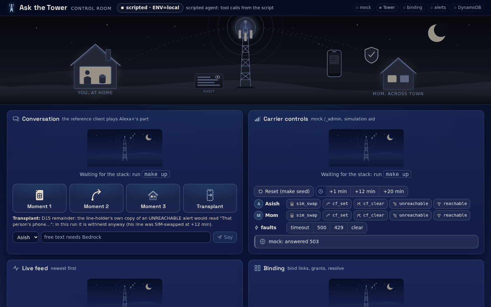
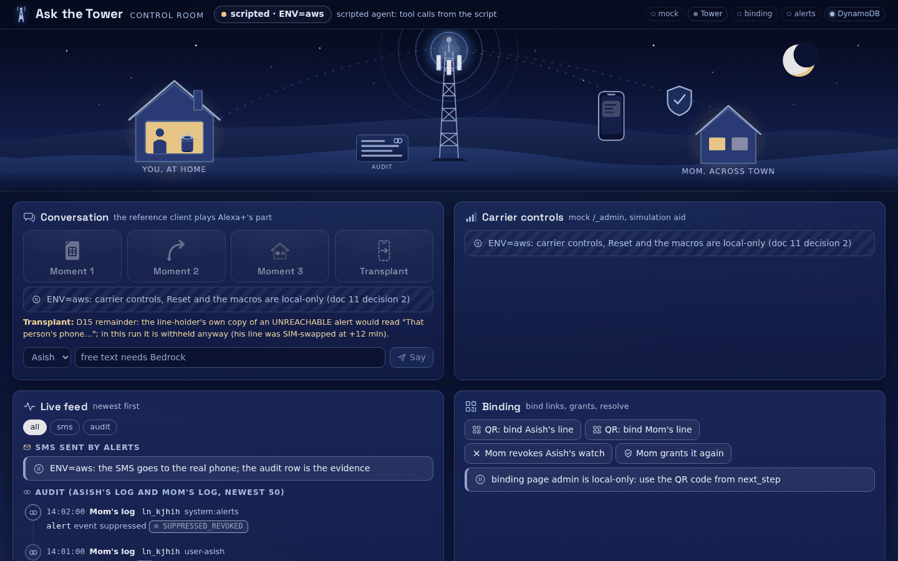
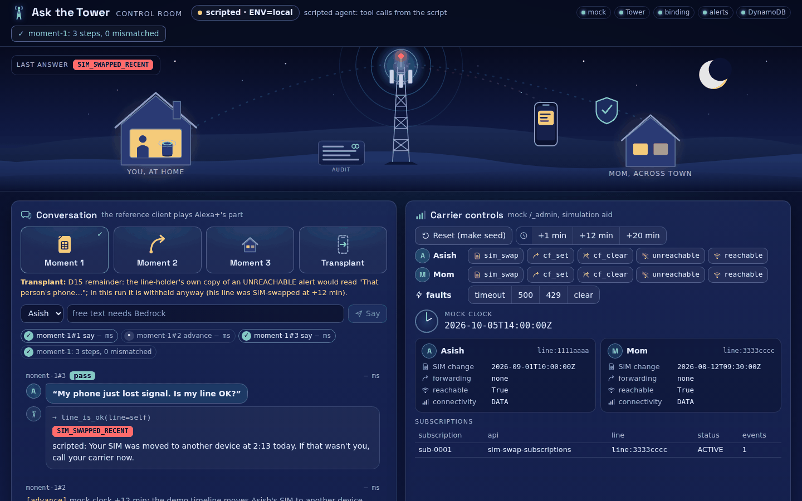
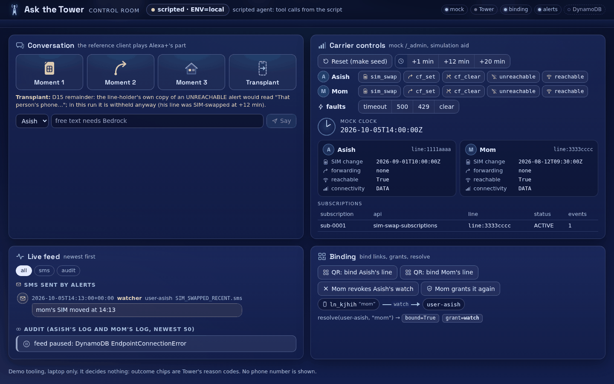
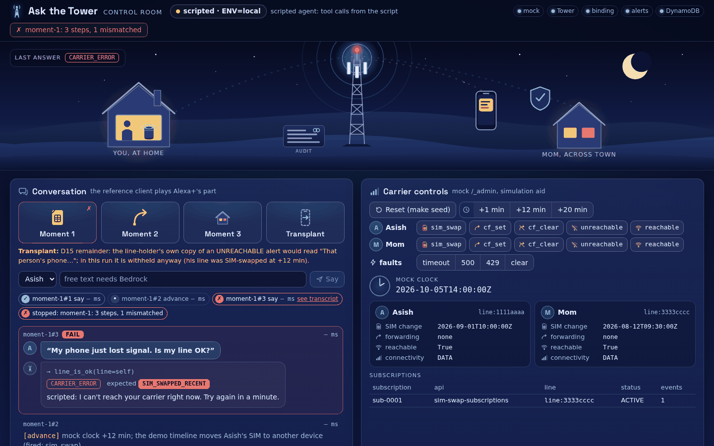

# demo-ui — the demo control room

One browser page for presenting and rehearsing the demo: the conversation, the carrier's state, the live alerts
and audit rows, and the binding QR code, side by side. Design: [`docs/architecture/components/11-demo-ui.md`](../../docs/architecture/components/11-demo-ui.md),
diagram [`11-demo-ui`](../../docs/architecture/diagrams/png/11-demo-ui.png).

**What it is.** FastAPI + HTMX, one static page, no build step (HTMX 2 and its SSE extension are vendored in
`src/demo_ui/static/`). The reference client is used as a library: the macro buttons run
`ref_client.demo.STORIES` through `run_demo(reset=False, on_step=…)`, the same code and steps as `make demo`,
with a pass/fail badge per step.

**What it is not.** Not part of the product and not on any path (e2e §3–§5): it owns no table, decides nothing
(outcome chips are Tower's `reason_codes`), makes no CAMARA or Gateway call, holds no key, never shows or handles a
phone number, and is **never deployed to AWS** (no ECR repository, no Terraform, `values-eks` `enabled: false`).
There is no `prompts/` folder: the UI has no agent role of its own.

| Pane | Does |
|---|---|
| 1 Conversation | macros Moment 1, 2, 3, Transplant (Reset → earlier stories replayed → this one, badges + timings); free text as Asish or Mom with Bedrock; environment pill (`scripted`/`bedrock` · `ENV`) |
| 2 Carrier controls | Reset (= `make seed`), clock +1/+12/+20 min, line events by the mock's opaque `ref`, faults; state by holder |
| 3 Live feed | SMS from Alerts' `GET /internal/sent` (role, template, body), shown on a mocked phone (U4), and the last 50 audit rows read as each line's owner |
| 4 Binding | bind link as a QR code (drawn here with `segno`), grants, `resolve`, Mom's revoke / re-grant |
| 5 Ops | closed by default: "Run here" runs an allowlist of local `make` targets with a streamed, redacted log; "AWS pipeline" is a read-only checklist with copyable commands (see "Ops pane" below) |

## Look

A night-time operations room over a town (doc 11 §2 "Presentation"): a top bar (wordmark, the mode pill, a
five-dot health strip, the run status), **the Stage** (your house, the tower with the audit ledger at its foot,
Mom's house with the consent shield, the phone that receives texts), then the four panes as glass cards.
Only the presentation is new: the routes, SSE events, feed sources, fragment names and their context variables,
`redact.py`, the `HX-Request` check, the token cookie, the poller and the runner are unchanged.

| Asset | What it is |
|---|---|
| `static/index.html` | the page, served raw (not Jinja); every HTMX target id is unchanged |
| `static/app.css` | the only stylesheet: tokens, cards, chips (`.rc-<CODE>` for every reason code), stepper, timeline, phone frame, the five states |
| `static/stage.js` | ES module: fetches `img/scene.svg` once, inlines it, then only toggles classes from the SSE frames and the fragments' `data-*` |
| `static/img/scene.svg`, `icons.svg`, `empty-state.svg` | vector art derived from `docs/img/hero.svg`; fragments reference the sprite with `<use>`, never inline geometry |
| `static/fonts/SpaceGrotesk-wght.woff2` + `LICENSE` | Space Grotesk 2.0.0 variable (300–700), SIL OFL 1.1, from the upstream repository `floriankarsten/space-grotesk` at commit `03507d0` (`fonts/woff2/SpaceGrotesk[wght].woff2`, sha256 `8e085aa4…a4b08c07`); title and pane names only, the UI text is `system-ui` |

**Colour has one meaning per hue:** cyan the request path, amber proactive and SMS, mint consent and OK, coral a
refusal or an alert (solid: the line changed or an alert failed; outline: Tower refused), slate grey withdrawn or
raw state (`SUPPRESSED_REVOKED` with a ⊘). Chip text is always Tower's reason code verbatim. The carrier pane's
state chips are neutral on purpose: the UI never calls a SIM change "recent", because that is policy.

**The Stage, driven by what the page already receives:** a `say` turn lights the cyan beam from your house (from
Mom's house for her free-text turns) and floats its reason codes up from the tower; a coral code turns the beacon
coral and keeps it so until the next answer; a carrier state change (or a `fire`/`advance` step) pulses the
rings; a new SMS sends the amber pulse to the phone and buzzes it; a new audit row ticks the ledger; a
`SUPPRESSED_REVOKED` row flashes the shield, and the shield shows a grey slash while `resolve` says Mom's grant is
`none`. Clicking either house scrolls to the Binding pane. Replayed frames on connect set the state without
animating; `prefers-reduced-motion` turns the motion off and keeps the state.

**The five states:** (1) stack down: every pane shows the dark-tower picture with "Waiting for the stack: run
`make up`" and each fragment's own reason; (2) ENV ≠ local: the carrier pane and the story tiles are hatched with
the reason verbatim; (3) no Bedrock: the pill reads `scripted · ENV=…` with the note as text and tooltip, free
text stays disabled; (4) feed paused: a banner with a pause icon in the audit lane, the SMS lane goes on;
(5) a failed step: a coral ✗ node in the stepper with a "see transcript" link, and a "stopped" node with the run
status verbatim.

The five states at 1440×900, as `tests/test_visual.py` takes them (the real app under uvicorn over the test fakes
and moto, fixed data, step timings shown as "— ms"). The images below are copies of those shots in
`docs/img/demo-ui/` (256-colour PNG, each ≤ 150 KB; taken 2026-10-11). The test's own baselines
(`tests/visual/baseline/`) and each run's shots (`artifacts/screenshots/demo-ui/<state>.png`) are gitignored and
exist only on the machine that ran the tests.

| State | Screenshot | Generated locally |
|---|---|---|
| 1 stack down |  | `artifacts/screenshots/demo-ui/stack-down.png` |
| 2 ENV ≠ local |  | `artifacts/screenshots/demo-ui/env-not-local.png` |
| 3 no Bedrock (scripted pill), after Moment 1 |  | `artifacts/screenshots/demo-ui/moment-1-scripted.png` |
| 4 feed paused |  | `artifacts/screenshots/demo-ui/feed-paused.png` |
| 5 a failed step |  | `artifacts/screenshots/demo-ui/failed-step.png` |

`artifacts/screenshots/demo-ui/moment-1-reduced-motion.png` is the reduced-motion variant; it must match the
`moment-1-scripted` baseline (the same state, run without the motion). After an intended visual change, run
`DEMO_UI_UPDATE_BASELINES=1 uv run pytest services/demo-ui/tests/test_visual.py -m nightly`, look at the new PNGs,
and refresh the `docs/img/demo-ui/` copies if the README should show the change. Baselines are tied to the renderer
that wrote them (Chromium build and system fonts), which is why they stay local.

## Run

```bash
make up              # the stack, including this UI in compose at http://127.0.0.1:8090 (scripted agent)
make showcase-ui     # the judge-facing run: the UI on the host at http://127.0.0.1:8091, Bedrock when AWS credentials resolve
```

On the host without make: set the variables below (see `.env.example`) and `uv run demo-ui`. On ENV=aws, run
`make showcase-ui ENV=aws`: the UI reads `deploy/.env.aws` itself. With the demo admin path closed (the default)
the conversation (Asish only) and the audit feed work; the carrier pane, Reset and the macros are off with
"admin path closed: see pane 5 step 6"; pane 4 shows only the QR code from Tower's `next_step`; the pill reads
`… · ENV=aws · admin off`. With the path open (`demo_admin_cidrs` = your /32, 10 §2.1) the pill reads
`admin on`, and the carrier pane, the SMS lane (from `SentSms`), pane 4, Reset and Moment 1–3 work against the
deployment; Transplant stays local, with its caption.

## Config

| Variable | Default | Meaning |
|---|---|---|
| `ENV` | `local` | `local`, `eks`, `aws`; not `local` → pane 2, Reset and macros off (doc 11 decision 2), Asish only |
| `TOWER_URL`, `TOWER_BEARER` | `http://localhost:8080/mcp`, — | Tower's MCP endpoint and bearer (a JWT on AWS) |
| `MOCK_URL`, `MOCK_ADMIN_TOKEN` | `http://localhost:8443`, — | the mock's `/_admin` and its bearer (08 §3, G1; local); empty URL → pane 2 off |
| `BINDING_URL` | `http://localhost:8081` | the binding page's local admin (`/_admin/*`, 404 off-local) |
| `ALERTS_URL`, `ALERTS_INTERNAL_BEARER` | `http://localhost:8082`, — | `GET /internal/sent` (06 §3.1, G3); the bearer only locally |
| `DYNAMO_ENDPOINT` (`TOWER_DYNAMODB_ENDPOINT`), `TOWER_TABLE_PREFIX`, `AWS_REGION` | `http://localhost:8000`, ``, `us-east-1` | audit reads; with an endpoint, DynamoDB Local's placeholder credentials are set in code, never in `AWS_*` |
| `REF_AGENT`, `BEDROCK_MODEL_ID` | `auto`, `amazon.nova-micro-v1:0` | `auto` = Bedrock when credentials resolve |
| `DEMO_UI_HOST`, `DEMO_UI_PORT` | `127.0.0.1`, `8090` | listen address (`make showcase-ui` sets `8091`, from `SHOWCASE_UI_PORT`) |
| `DEMO_UI_PUBLISHED_LOOPBACK` | `0` | `1` = listens on 0.0.0.0 but is published on 127.0.0.1 only (compose, kind) |
| `DEMO_UI_TOKEN` | — | required for a non-loopback listen; open once with `?token=` (HttpOnly cookie) or send a bearer |
| `FEED_POLL_S` | `2` (`5` off-local) | feed poll interval; the poller runs only while a page is open |
| `DEMO_ALERTS_SETTLE_S` | `2.5` (`0` off-local) | macro pause after a clock jump Alerts acts on, so the Transplant macro shows both contacts' texts (06 §11.4) |
| `DEMO_UI_SEED_PATH` | the checkout's `deploy/compose/seed/seed.py` | the `make seed` module Reset runs (copied into the image) |
| `DEMO_UI_CHECKOUT` | found from the package location | the repo root (holds `Makefile` and `mk/`): the Ops runner's `cwd` and where the checklist reads `artifacts/` |
| `DEMO_UI_AWS_ENV_FILE` | `<checkout>/deploy/.env.aws` | ENV=aws only: read at start; for its keys (`TOWER_URL`, `BINDING_URL`, `BINDING_ADMIN_URL`, `MOCK_URL`, `ALERTS_URL`, `WEB_CHAT_URL`, `DEMO_ADMIN_BEARER`, `TOWER_TABLE_PREFIX`, `AWS_REGION`) the file wins over the shell |
| `DEMO_UI_COGNITO_USERS` | `<checkout>/artifacts/cognito-users.json` | ENV=aws only: Asish's and Mom's Cognito subs for Reset and the Grant step; missing → Reset and macros off with "run `make cognito-users ENV=aws`" |
| `BINDING_ADMIN_URL`, `BIND_ADMIN_TOKEN` | `BINDING_URL`, — | where pane 4 and the AWS Reset call `/_admin/*`; on AWS the execute-api URL (required there). `BIND_ADMIN_TOKEN` is never used on ENV=aws |
| `DEMO_ADMIN_BEARER` | — | ENV=aws, from `deploy/.env.aws`: the one bearer of the demo admin path, sent on every call to the mock's, Alerts' and the binding page's admin routes (10 §2.1, decision 1 of 2026-10-11). The local tokens (`MOCK_ADMIN_TOKEN`, `ALERTS_INTERNAL_BEARER`, `BIND_ADMIN_TOKEN`) are never sent on ENV=aws |

The two file defaults apply only to the real process (`Settings.from_env()`); a test that passes its own mapping
names its files explicitly, so a developer's own `deploy/.env.aws` never leaks into a test.

Every POST needs the `HX-Request` header that HTMX sends, so another web page cannot drive the UI on 127.0.0.1.
Logs are JSON lines with event names and counts; uvicorn's access log is off; every fragment and SSE frame passes
the number filter (`redact.py`). `/healthz` reports the mode, `ENV` and which panes are live, never a setting.

## Ops pane

Pane 5 sits under the four panes, in a `<details>` closed by default (doc 11 §2 "Pane 5", prompt 22).

**What runs here.** Only the eleven targets in `src/demo_ui/ops/allowlist.py`, each as the fixed argv
`make <name> ENV=local`: `up`, `down`, `seed` (stack); `demo`, `showcase-tower`, `showcase-alerts`,
`showcase-binding` (demo); `test-unit`, `test-integration`, `test-e2e`, `test-report` (tests). They run on this
laptop as the user who started `make showcase-ui`, one at a time and never beside a macro (409 "running: <name>"),
in their own process group (Stop: SIGINT, SIGTERM after 1.5 s, SIGKILL at 2 s), with the checkout as `cwd`. The
log streams on the existing `/events` stream (`ops` frames every 200 ms, `ops-status` at the end: `pass`, `fail`
or `stopped` with exit code and duration). Every line passes `redact.mask_secrets` (bearers, `*_TOKEN=`-style
assignments, `AKIA`/`ASIA` ids, the UI's own secrets and the secret values of `deploy/compose/.env`) and
`redact.mask` (numbers); nothing is written to disk. With the stack down (mock, binding page or Alerts not
answering `/healthz` in 2 s) the targets that need it are disabled and `up` is the call to action.

**What never runs.** No free text, no shell, no target with `ENV=aws|eks`, no Terraform, no `aws` CLI: `ecr-up`,
`push`, `plan`, `deploy`, `cognito-users`, `seed-aws`, `outputs`, `web-chat-sync` and the rest of doc 11 §2's
"never" list are refused by name when `allowlist.py` is imported. The child's environment is an allow-list (PATH,
HOME, locale, CA bundles, proxies, Docker and uv settings, plus `NO_COLOR=1 PYTHONUNBUFFERED=1 TERM=dumb`); no
`AWS_*`, `TF_VAR_*`, `COGNITO_*`, `*_TOKEN`, `*_BEARER`, `*_SECRET`, `*_PASSWORD`, `*_KEY`, `VIRTUAL_ENV` or `ENV`
from the UI's process reaches it. The child `make` still reads the repo's `.env` itself, exactly as in a terminal;
`ENV=local` on the argv is what keeps it local. "Run here" is off, with the reason on screen, with `ENV=aws`
("nothing runs here; use the commands on the right in a terminal"), in the compose and kind containers
(`DEMO_UI_PUBLISHED_LOOPBACK=1`), without `make`, or without a checkout. Changing the allowlist means changing
`allowlist.py` **and** the table in doc 11 §2 in the same change: `tests/test_ops_allowlist.py` compares them.

**How the AWS checklist reads state.** Seven steps, read-only, re-checked every 15 s and on "re-check" (which
skips the 5 s cache): ECR repositories (`artifacts/tf-outputs-ecr.json`), images pushed (`artifacts/image-tag`),
deployed (`deploy/.env.aws` + `GET {BINDING_URL}/healthz`), users seeded (`artifacts/cognito-users.json` +
`artifacts/seed-aws.json`), web chat live (`artifacts/web-chat-sync.json` + `GET {WEB_CHAT_URL}`), admin path
(`GET {MOCK_URL}/_admin/clock`), AWS test report (the `End to end (ENV=aws)` row of `artifacts/test-report.md`).
States `todo · done · warn · fail · off`; a malformed file is that step's `fail` with the reason. Probes are
unauthenticated GETs with a 2 s timeout; no bearer is ever sent and no URL from `.env.aws` is shown. Each step
shows the exact terminal command with a copy button; the UI never runs it (`ops/aws_status.py` imports no AWS SDK
and starts no process).

**Admin on AWS.** Off by default. To open it for a demo window: `demo_admin_cidrs = ["<your public IP>/32"]` in
`deploy/terraform/envs/aws.tfvars`, `make plan && make deploy` (re-runs `make outputs`, which writes the admin
URLs and `DEMO_ADMIN_BEARER` into the gitignored `deploy/.env.aws`), then `make showcase-ui ENV=aws`: step 6 reads
"admin on" (its headerless probe gets 401 from the open gate), the pill `admin on`; Reset (mock scenario load, which
also puts the Fargate mock's clock at wall time → Alerts `POST /internal/reset` → Mom's re-grant through the
binding page's bearer-mode admin, every call with `DEMO_ADMIN_BEARER`, stopping at the first non-2xx with its
status), then Moment 1–3. Changing the address list replaces the bearer and rolls the mock task: re-run
`make outputs ENV=aws`, restart the UI, press Reset. To close it: `demo_admin_cidrs = []`, `make deploy`; step 6
reads `off` and the panes show the closed message again. From an address outside the list, or with a stale bearer,
every admin call is 403 ("mock load: 403").

## How to showcase

`make up && make showcase-ui`, open http://127.0.0.1:8091 (the compose container keeps 8090; `SHOWCASE_UI_PORT=<port>`
picks another, and a port already in use is reported before anything starts). Press Moment 1, 2, 3, then Transplant: every badge
is green; the feed shows the watcher's SMS (`watcher`, named "mom"), then the `SUPPRESSED_REVOKED` row, then the
partner's (`escalation[0]`) and the neighbour's (`escalation[1]`) texts. "QR: bind Asish's line" draws a bind link
a phone on the same Wi-Fi can scan (the caption says nothing texts it yet: D1). What it proves: the same
transcripts as `make demo`, live, in one view — nothing the other showcases don't already prove.

Pane 5: with the stack down, open Ops: only the targets that need no stack are enabled and the AWS column shows
what exists ("Nothing deployed yet" on a fresh checkout). Press `up`, watch the log stream and the badge turn
green; then `seed`, `demo`, `test-unit`. On AWS, after the admin-open sequence above: step 6 "admin on"; Reset,
Moment 1–3; the SMS phone fills from `SentSms`. Close the path afterwards.

## How to test

```bash
uv run pytest services/demo-ui -m "unit or integration"   # unit (config, redaction, macro sequencer, feed, views) + integration (app over ASGI, moto, Playwright smoke)
uv run pytest services/demo-ui/tests/test_visual.py -m nightly   # pixel baselines + reduced motion + axe (nightly; also in `make test-nightly`)
```

The fuller suite (privacy on the wire, macros vs golden over the in-process stack, import graph, never-on-AWS
static test, Playwright smoke) is doc 11 §11. Presentation (prompt 21): `test_assets.py` (no external request
target, `static/` ≤ 600 KB, a colour class per reason code, no number in any picture, the font licence),
`test_fragment_privacy.py` (all sixteen fragments masked, attributes included; pane 5 added four) and `test_visual.py` (the five states
against `tests/visual/baseline/`, 0.5 % pixel tolerance, reduced motion, no request off 127.0.0.1). `test_visual.py`
is layer `nightly`, not `make test-integration`: its baselines are local (gitignored) and tied to this machine's
renderer. With no baseline it writes one and skips saying so; re-run to compare. Each shot is taken under emulated
reduced motion once the page is quiet, after `document.fonts.ready` and network idle, and a capture over 0.5 % is
retaken and compared once more at the same limit. Its axe-core check runs when `AXE_CORE_JS` names a local
`axe.min.js` (injected into the page from disk, never from a CDN), and skips otherwise. The stepper-fold check
(Moment 2 after Moment 1 in one page) is a behaviour test and stays `integration` in `test_stepper_replay.py`.

Pane 5 and ENV=aws (prompt 22): `test_ops_allowlist.py` (unit: the allowlist equals doc 11's table, argv rules,
the O2 names, denied keys refused at import, the child env, `mask_secrets`), `test_ops_runner.py` (integration,
real subprocesses with test targets: ordered masked frames, Stop of a whole group within 2 s, 409, exit codes,
no parent credential in the child), `test_ops_aws_status.py` (unit: each step absent/present/malformed, probes
200/403/404/timeout over `httpx.MockTransport`, no `Authorization`, no SDK or process import),
`test_ops_routes.py` (integration: guards, 404, ENV=aws and container mode off, frames on `/events`, the stack-down
state, every checklist state), `test_config_aws.py`, `test_aws_reset.py`, `test_aws_macros.py` (ENV=aws with the
admin path open: the file wins, the HTTP Reset order and bearers, Moment 1–3, Transplant off, `admin on`).
No test runs a real target of the allowlist.
